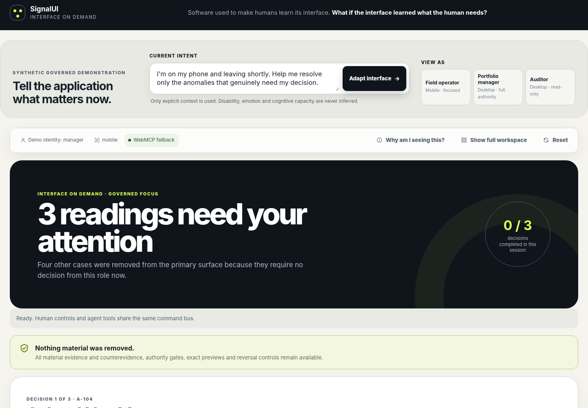

# SignalUI: Interface on Demand

> **Software used to make humans learn its interface. What if the interface learned what the human needs?**

SignalUI Interface on Demand is a complete reference vertical for governed adaptive interfaces. It takes an explicit human intent, role, device and accessibility profile; intersects them with application capabilities, current state and authority; then compiles the smallest adequate interface from validated surface recipes.

Human controls and WebMCP tools operate the **same command bus, state, approval rules and receipt chain**. The runtime never generates arbitrary HTML, React or Razor code.



## What the demonstration proves

The synthetic energy-reading workspace begins as a realistic portfolio dashboard. It can recompile into:

- a full operations workspace for a portfolio manager;
- a three-decision mobile surface for a field operator;
- a read-only provenance and receipt surface for an auditor.

The same vertical includes:

- eight semantic capability contracts;
- three validated surface recipes;
- dynamic WebMCP registration with a no-API fallback console;
- manager-only, version- and fingerprint-bound approval;
- material evidence and counterevidence preservation;
- denied-action receipts and an append-only hash-linked history;
- deterministic build output;
- unit, WebMCP-eval, Chromium E2E and accessibility proof.

## Quick start

### Requirements

- Node.js **22 or newer**
- TypeScript **5.8.x** available through `npm install` or on `PATH`
- Chromium for browser proof. Linux falls back to `/usr/bin/chromium`; CI supplies its setup-Chrome executable through `CHROMIUM_PATH`. macOS development auto-detects Google Chrome, and `CHROMIUM_PATH` can explicitly select another browser executable.

### Install and verify

```bash
npm install
npm run verify
```

### Run locally

```bash
npm run build
npm start
```

Open the printed local URL. The server defaults to `127.0.0.1:4173`; deployment environments can set `HOST=0.0.0.0` and `PORT`.

### Main commands

```bash
npm run validate     # validate capability and surface contracts
npm run typecheck    # TypeScript type check
npm run test:unit    # deterministic core and tooling tests
npm run build        # produce dist/ and a SHA-256 build manifest
npm run eval         # run five governed WebMCP journey evals
npm run test:e2e     # run the complete Chromium journey
npm run test:a11y    # run DOM and accessibility-tree checks
npm run verify       # run the entire clean verification conveyor
npm run release:check # scan release files, markers, secrets and whitespace
```

## Three-minute journey

1. Start in the full manager workspace.
2. Submit: **“I’m on my phone and leaving shortly. Help me resolve only the anomalies that genuinely need my decision.”**
3. SignalUI recompiles the page into exactly three evidence-backed decisions while preserving counterevidence, explanation and reversal controls.
4. As an operator, propose `4,829 kWh` for School No. 14 and request manager approval.
5. Observe that operator approval is denied and recorded.
6. Switch explicitly to the manager demo identity and approve the exact current fingerprint.
7. Switch to auditor and inspect the human/agent receipt chain.

The complete recording script is in [`docs/demo-script.md`](docs/demo-script.md).

## Architecture at a glance

```text
Explicit human context
        │
        ▼
Capability contracts ── current state ── authority policy
        │                       │
        └──────────┬────────────┘
                   ▼
        deterministic surface compiler
             ┌─────┴─────┐
             ▼           ▼
        human UI      WebMCP tools
             └─────┬─────┘
                   ▼
           shared CommandBus
                   ▼
      evidence · approval · receipts
```

See [`docs/architecture.md`](docs/architecture.md) for the boundaries and data flow.

## Security model

- Interface adaptation cannot grant authority.
- `set_interface_context` cannot change the authenticated actor role.
- Every write is re-admitted at execution time.
- Consequential approval is bound to anomaly ID, proposal, evidence digest, current version and fingerprint.
- Stale, duplicated, malformed and unauthorized calls fail closed and produce non-mutating receipts.
- Untrusted evidence remains data and is never interpreted as instructions.
- The static server sends a self-only CSP, `Permissions-Policy: tools=(self)`, no-sniff, no-referrer and anti-framing headers.
- Only the explicit demo profile preference is stored in `sessionStorage`; operational state and authority are not treated as browser-persisted truth.

This is a synthetic reference vertical, not a production authentication or multi-tenant service. Read [`SECURITY.md`](SECURITY.md) before adopting it.

## Browser and WebMCP behavior

Where the browser exposes the imperative WebMCP API, the bridge registers currently admitted tools through `document.modelContext.registerTool()` and refreshes them with `AbortSignal`. In other browsers, the fallback console invokes the same tool catalog and command bus, so the workflow remains demonstrable without pretending native WebMCP is available.

The browser harness uses real Chromium DOM, JavaScript, screenshots and accessibility tree. The test environment’s managed Chromium policy blocks local navigation, so the harness injects the compiled distribution into an isolated `about:blank` target. The static HTTP server is verified separately. Full details are in [`docs/verification.md`](docs/verification.md).

## Repository map

```text
contracts/                 capability and surface-recipe contracts
evals/                     WebMCP journey specifications
public/assets/             synthetic evidence artwork
scripts/                   build, server, validation, eval and CDP tooling
src/core/                  types, policy, compiler, state, commands, receipts
src/ui/                    validated template grammar and browser orchestration
src/webmcp/                native registration and fallback adapter
tests/                     unit, browser and accessibility proof
.github/workflows/          clean CI verification and proof upload
docs/                      architecture, tools, demo, adoption and verification
```

## Adoption path

This standalone TypeScript vertical keeps clean seams for the canonical .NET/Blazor SignalUI product:

- contracts and validators become `SignalUI.Core` records and diagnostics;
- `SurfacePlan` becomes the portable adapter input;
- templates map to approved `SignalUI.Blazor` blocks;
- the command bus maps to host-owned authenticated handlers;
- the WebMCP bridge remains a thin browser adapter over the same contracts.

See [`docs/adoption-path.md`](docs/adoption-path.md).

## Deployment

The repository includes a Cloudflare Pages configuration, static `_headers`, a web-app manifest, a dependency-free Node server, a two-stage Docker image and a `Procfile`. No external environment is changed by the build. Deployment commands and post-deployment checks are documented in [`docs/deployment.md`](docs/deployment.md).

## Scope boundary

Included: a complete synthetic reference product, contracts, runtime, UI, WebMCP bridge, safety model, tests, evidence and deployment-ready static server.

Not claimed: production authentication, durable backend storage, real meter integrations, tenant isolation, external side effects, public package publication, or canonical SignalUI host adoption.

## License

MIT © 2026 Ion Brînzilă. See [`LICENSE`](LICENSE).
