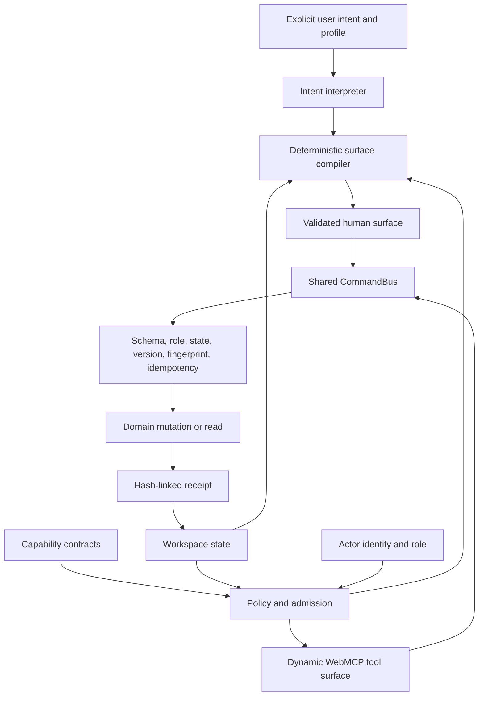

# Architecture

## Product boundary

SignalUI Interface on Demand is a vertical reference product, not a generic page generator. It proves one reusable architecture against a governed anomaly-review workflow:

> explicit context + capabilities + state + authority → validated surface plan → shared commands → receipts

The system owns interface composition and local reference behavior. A production host must own authentication, authoritative data, external side effects and deployment policy.

## Layers



### `contracts/`

Machine-readable capability and surface-recipe documents. Contracts describe semantics, schemas, effects, roles, annotations and state availability. They do not contain host handlers.

### `src/core/`

- `types.ts`: portable data and contract types.
- `schema.ts`: fail-closed contract and input validation.
- `fixtures.ts`: deterministic synthetic domain state.
- `hash.ts`: canonical serialization, stable hashes and SHA-256.
- `store.ts`: immutable observable in-memory state.
- `preferences.ts`: non-authoritative explicit profile preference storage.
- `policy.ts`: role and coarse workflow-state admission.
- `intent.ts`: bounded explicit intent interpretation without personal-state inference.
- `compiler.ts`: deterministic `SurfacePlan` production.
- `commands.ts`: command helpers and input validation.
- `command-bus.ts`: final execution authority and domain transitions.
- `receipts.ts`: input/state/lineage hashes.

### `src/webmcp/`

`WebMcpBridge` projects admitted capabilities into native WebMCP tools when available. Tool lifecycle is refreshed with `AbortSignal`. The fallback adapter exposes the same definitions and executes through the same command bus.

A known capability that is not currently exposed can still be deliberately probed by the fallback test console; the command bus—not the UI—makes the final decision and creates a denial receipt. Native agents cannot discover dynamically unregistered tools.

### `src/ui/`

The UI renders only the three approved recipes. Templates escape untrusted strings, preserve material evidence, and expose explanation/reversal controls. The app orchestrator never mutates domain state directly; writes flow through `CommandBus.execute()`.

## Authority model

The interface role is a projection of actor identity. It is not a user-editable permission.

```text
actor role = operator
requested context role = manager
                ↓
        context-role-mismatch
                ↓
    no operational state mutation
                ↓
          denial receipt
```

The profile switcher is an explicit synthetic identity simulator. A production adapter must replace it with host authentication.

## Surface compilation

`compileSurface(context, state)` is deterministic. It selects:

- `full-workspace` for portfolio overview;
- `focused-decisions` for bounded anomaly resolution;
- `audit-trail` for auditor/recent-decision review.

The focused recipe is constrained by decision budget but may not omit material evidence or counterevidence for selected decisions. Every plan carries an explanation and state hash.

## Consequential approval

The approval journey is:

```text
open
  → propose_correction (non-final)
  → request_human_approval (exact preview + fingerprint)
  → approve_correction (manager only)
  → corrected
```

The fingerprint binds the current anomaly, proposal, evidence digest and expected version. Any relevant change invalidates approval. Reusing the same command ID is denied by idempotency protection.

## Receipt chain

Every command—including reads and denials—creates a receipt with:

- actor ID, role and source;
- capability and command ID;
- canonical input digest;
- prior and current operational state hashes;
- previous receipt hash;
- outcome, summary and optional reason/anomaly.

A denial keeps prior/current operational hashes equal while extending the audit lineage.

## Persistence correction

Operational state remains in memory in this reference vertical. Persisting client-side domain mutations could falsely imply backend authority. Only the explicitly chosen demo profile is stored in `sessionStorage`, with a safe memory fallback where storage is unavailable. Production adoption requires server-authoritative state and receipts.

## Failure behavior

- Invalid contracts stop bootstrap and render a fail-closed message.
- Invalid input, role, state, version, fingerprint and duplicate commands are denied.
- Native WebMCP absence selects the fallback without changing semantics.
- Storage denial falls back to memory.
- Browser tool output is bounded to 32,000 characters.
